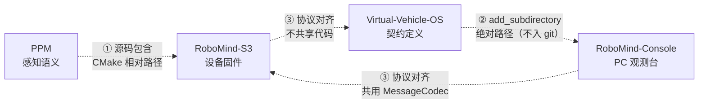

# 项目集群总索引

> **这份文档解决一个问题：四个仓库分开看时，改一处不知道还要同步哪里。**
> 它只写**全局视角**——每个仓库自己的细节在各仓库的 README / 设计文档里，本文只指路。
>
> **本文可进 git**（是给协作者看的，不是内部工作笔记）。
> 维护位置：`RoboMind-S3/docs/PROJECTS.md`（选这里是因为 RoboMind-S3 是集成中心：固件与 PC 端都围绕它）。

---

## 1. 四个仓库各自的定位

| 仓库 | 路径 | 一句话定位 | 关键产物 |
|---|---|---|---|
| **Virtual-Vehicle-OS**（VVOS） | `E:/Github Project/Virtual-Vehicle-OS` | **通信契约的定义者**：定义"消息长什么样"（11 字段 wire 格式）、信封语义（topic/sequence/ttl/source）与传输抽象 | `MessageCodec`、`MessageEnvelope`、`Bridge` |
| **PPM** | `E:/Github Project/PPM` | **感知语义的生产者**：硬件无关的视觉决策中间件，把像素变成"疲劳/眼睛/在场"这类判定（纯 C ABI，**不含模型**） | `include/ppm.h`、`ppm_run` |
| **RoboMind-S3** | `E:/Github Project/RoboMind-S3` | **集成中心 / 设备本体**：ESP32-S3 固件（摄像头 + 屏 + 音频 + WiFi），把 PPM 的判定编码成 wire 帧发出去 | `main/ppm_producer.cpp`、`main/wire_codec.cpp` |
| **RoboMind-Console** | `E:/Github Project/RoboMind-Console` | **PC 端观测台**：Qt6 应用，接收板子的 wire 帧、用 VVOS 的 `MessageCodec` 解码并显示 | `robomind-console`（GUI）、`selfcheck` / `framecheck`（无 GUI 校验） |

**四者的关系不是"四个模块"，是"一条链路的三段 + 一份契约"**：

```
PPM（产生语义） → RoboMind-S3（编码 + 发送） → RoboMind-Console（解码 + 显示）
                          ↑                            ↑
                          └──── VVOS 定义的契约 ────────┘
```

---

## 2. 依赖关系（三种形式，性质完全不同）



| # | 形式 | 具体 | 性质 |
|---|---|---|---|
| ① | **源码包含** | `RoboMind-S3/components/ppm/CMakeLists.txt`：`set(PPM_ROOT "${CMAKE_CURRENT_LIST_DIR}/../../../PPM")`，SRCS 直接引用 `PPM/src/**.cpp` | **跨仓库相对路径**——不复制源码，但**要求四个仓库保持同级目录布局** |
| ② | **CMake 子工程** | `RoboMind-Console/CMakeLists.txt`：`set(VVOS_ROOT "E:/Github Project/Virtual-Vehicle-OS" CACHE PATH ...)` + `add_subdirectory("${VVOS_ROOT}" vvos_build)` | **绝对路径，且不在 git 里** ⇒ 换机器必须 `-DVVOS_ROOT=...` |
| ③ | **协议对齐（无代码共享）** | `RoboMind-S3/main/wire_codec.cpp` 是 `MessageCodec` 的**独立实现**；两侧靠测试向量对齐 | **一致性靠判据，不靠编译期** ⇒ 改格式必须两侧同步（见 §4） |

### ⚠️ 致命前提：**四个仓库必须位于同一父目录下**

`RoboMind-S3/components/ppm/CMakeLists.txt` 用的是 `../../../PPM` —— **假定四个仓库同级**。

| 违反后果 | 具体 |
|---|---|
| 构建失败 | 报错是 **"找不到 `ppm_api.cpp`"** |
| **但不提示真正原因** | **不会说"目录布局不对"** |
| 排障第一反应会查错方向 | 查 CMakeLists 的 SRCS 列表、查 `ppm_api.cpp` 是否被删 —— **都查不到真正原因** |

**clone 这个集群时必须按此布局放置，缺一不可**：

```
<任意父目录>/
├─ Virtual-Vehicle-OS/
├─ PPM/                 ← 必须是 RoboMind-S3 的同级兄弟
├─ RoboMind-S3/
└─ RoboMind-Console/
```

> **同族案例**（都是"报错位置与真实原因相距很远"）：`nm` 查不到符号 ⇏ 代码不在；`#if CONFIG` 判假 ⇏ 编译错误；**"找不到 PPM 源文件" ⇏ 源文件有问题**。
>
> **看到"找不到某个 PPM 源文件"时，第一件事是 `ls ..` 看父目录里有没有 `PPM/`，而不是打开 CMakeLists。**

---

## 3. 各自的"真相源"在哪（改一处时先来这里确认）

| 主题 | **唯一真相源** | 副本 / 消费方 |
|---|---|---|
| **wire 帧格式**（字段数、分隔符、转义规则、长度前缀） | **VVOS**：`src/interconnect/message_codec.cpp` + 规格 [`u02-u03-implementation-spec`](../../Virtual-Vehicle-OS/docs/u02-u03-implementation-spec-2026-11-13.md) | RoboMind `wire_codec.cpp`（副本）、Console `frame_stream.h`（副本） |
| **PPM 的 C ABI** | **PPM**：`include/ppm.h` | RoboMind `ppm_producer.cpp`、`ppm_semantics.h` |
| **PPM 的配置（profile）** | **PPM**：`profiles/fatigue_lite.json` | RoboMind 构建时 `file(READ ...)` 生成 `ppm_profile_generated.h`（**构建期读取，不是源码副本**） |
| **内存预算与真机实测** | **RoboMind-S3**：`docs/smoke/` | 所有内存结论 |
| **分支模型与合并门禁** | **RoboMind-S3**：`docs/BRANCHING.md` | 全集群适用 |
| **判据设计规范（怎么判断判据对不对）** | **VVOS**：`docs/three-way-integration-2026-11-13.md` §9 | 全集群适用 |
| **PC 端设计** | **RoboMind-S3**：`docs/PC_CONSOLE_DESIGN.md` | — |
| **板端 UI 设计** | **RoboMind-S3**：`docs/UI_DESIGN.md` | — |

> **一条规矩**：**副本永远不是真相源。** 改 `wire_codec.cpp` 之前必须看 VVOS 的 `message_codec.cpp`——**只看规格不够**，因为规格可能滞后于实现（本轮就发生过：规格写了 8 字段，实现已支持 11）。

---

## 4. 改动时的联动清单（最重要的一节）

### 4.1 改 **wire 帧格式 / 字段数**

| 顺序 | 动哪里 | 注意 |
|---|---|---|
| 1 | VVOS `src/interconnect/message_codec.cpp` | **实现是真相源**，先改这里 |
| 2 | VVOS 规格 `docs/u02-u03-implementation-spec` | 同步 §3.2 字段表 + §3.8 测试向量 |
| 3 | **RoboMind `main/wire_codec.cpp`** | **照 VVOS 实现改，不是照规格改** |
| 4 | RoboMind 规格 `ppm_semantics.h` 的 `static_assert` | 字段变了 sizeof 会变，断言会红——**那是好事** |
| 5 | Console `src/frame_stream.h` + `testdata/` | 基准包要重生成 |
| 6 | 三边测试向量一起更新 | 缺一边，两边都会"各自通过" |

### 4.2 改 **PPM 的 ABI**（`include/ppm.h` 的结构体）

| 顺序 | 动哪里 | 注意 |
|---|---|---|
| 1 | `PPM/include/ppm.h` | 只追加字段，提升 `PPM_ABI_MINOR` |
| 2 | RoboMind `ppm_semantics.h` + `ppm_producer.cpp` | 消费方跟着改 |
| 3 | **PPM 的 ABI 自检**（`ppm_version()` 的 `result_size`） | 两侧尺寸不一致会在 init 时拒 |
| 4 | 板端 `[ppm] abi result=` 日志 | M3 应显示新尺寸 |

### 4.3 改 **PPM 的 profile**（`profiles/fatigue_lite.json`）

| 顺序 | 动哪里 | 注意 |
|---|---|---|
| 1 | `PPM/profiles/fatigue_lite.json` | — |
| 2 | **RoboMind 构建会自动跟着变**（`main/CMakeLists.txt` 的 `file(READ)`） | **不需要改代码，但要重新编译** |
| 3 | ⚠️ **`output.fields` 若变化，wire 上的 payload 字段会变** | 这是最容易漏的一环：**profile 改了，payload 编码（`dv/dl/ev/...`）必须跟着改** |

### 4.4 改 **VVOS 的 CMake / 导出**

| 顺序 | 动哪里 | 注意 |
|---|---|---|
| 1 | `VVOS/CMakeLists.txt` | 必须用 `CMAKE_CURRENT_SOURCE_DIR`（**不是** `CMAKE_SOURCE_DIR`） |
| 2 | `vr_base_framework` 的 `PUBLIC` include | 父工程靠这个拿头文件（`13c46b0` 起） |
| 3 | Console 重新 configure | 它是 `add_subdirectory` 消费者 |

### 4.5 改 **板端任务 / 栈 / 内存布局**

| 顺序 | 动哪里 | 注意 |
|---|---|---|
| 1 | RoboMind `main/*.cpp` 的 `xTaskCreate` | 栈尺寸 |
| 2 | 重测 `docs/smoke/` 的基线与 `largest` | **产品态基线会变**（当前 11,232 / 4,352） |
| 3 | 更新所有引用该基线的判据 | 判据跟着栈走，不用判据压栈 |

---

## 5. 版本对齐状态

> **易变的数字不写死**。以下用命令自证；若与实际不符，**说明本表过期，先修表再做别的**。

| 仓库 | 分支 | HEAD | 远程 |
|---|---|---|---|
| Virtual-Vehicle-OS | `master` | `13c46b0` | `Nagi-226/Virtual-Vehicle-OS` |
| PPM | `master` | `625fbf4` | `git@github.com:Nagi-226/PPM.git`（**SSH**，其余三个是 HTTPS） |
| RoboMind-S3 | `master` | `2663057` | `Nagi-226/RoboMind-S3` |
| RoboMind-Console | `master` | `75c16ca` | ✅ 已推送 **`Nagi-226/RoboMind_Console`**（⚠️ **GitHub 仓库名用下划线**，本地目录名用连字符 `RoboMind-Console` —— 不一致是有意的，改 URL 时照抄上面的） |

**一条命令对齐全部**（HEAD）：

```bash
for d in Virtual-Vehicle-OS PPM RoboMind-S3 RoboMind-Console; do
  printf '%-22s ' "$d"; git -C "../$d" log --oneline -1 2>/dev/null || echo "(缺失)"
done
```

**一条命令验证远程是否真通**（**不能看 `git remote -v`**，它只证明本地配了路径）：

```bash
for d in Virtual-Vehicle-OS PPM RoboMind-S3 RoboMind-Console; do
  printf '%-22s ' "$d"
  git -C "../$d" ls-remote --heads origin >/dev/null 2>&1 && echo "可达 ✅" || echo "不可达 ❌"
done
```

**当前实测结果**：四个仓库**全部可达 ✅**（2026-11-13 18:20 用 `ls-remote` 核实，Console 的远程仓库已创建并推送）。

**当前状态要点**：

- VVOS 的可嵌入性已修**两层**：`c361c00`（自己构建时找不到自己的头）+ `13c46b0`（父工程消费时找不到 VVOS 的头）
- RoboMind-S3 与 Console 的 `master` 都已包含各自的 smoke 证据（`docs/smoke/`）
- **Console 已完成 M1–M3**：`selfcheck`/`framecheck` 可独立验证解码（M2）；TCP 接入 + 实时 PPM 面板（M3）已端到端验收通过 —— `fps=9.47`、`decode_fail=0`、`partial=0`，断连后 **3.1 s 自动重连**

---

## 6. 协作边界（谁可以动谁）

| 规矩 | 理由 |
|---|---|
| **RoboMind 侧工程师不碰 VVOS 的 `src/`** | VVOS 有自己的契约流程与门禁；跨仓直改会让"谁负责一致性"没人知道 |
| **PPM 仓库全程只读** | PPM 是上游依赖，改动必须走它自己的裁决流程（它有 `docs/STATE.md` 的派单机制） |
| **VVOS 的改动走它自己的分支 + 门禁** | 例：`fix/cmake-embeddable`、`fix/cmake-export-includes` |
| **RoboMind-S3 的 master 受保护**，合并需门禁 | 见 `docs/BRANCHING.md`：五组检查（构建/默认态零影响/行为/静态资源/文档），**技术改动一律全检** |
| **跨仓库改动由主理人协调** | 涉及两仓以上时，不要单方面改 |

**一条禁令**：**不要把某个仓库的源码复制到另一个仓库**。当前所有跨仓关系都是"引用"（路径或协议），一旦复制就会出现第二份真相源——这正是这个集群一直在避免的。

---

## 7. 一页看完的速查

| 我想… | 去哪个仓库 | 看哪个文件 |
|---|---|---|
| 知道消息长什么样 | VVOS | `src/interconnect/message_codec.cpp` + 规格 §3.2 |
| 知道 PPM 能产出什么字段 | PPM | `include/ppm.h` |
| 知道板子现在有多少内存余量 | RoboMind-S3 | `docs/smoke/` |
| 知道能不能合 master | RoboMind-S3 | `docs/BRANCHING.md` §3 |
| 写一条新判据 | VVOS | `docs/three-way-integration-2026-11-13.md` §9 |
| 改 PC 界面 | RoboMind-S3 | `docs/PC_CONSOLE_DESIGN.md` |
| 改板子屏幕 | RoboMind-S3 | `docs/UI_DESIGN.md` |
| 接一个新设备/新协议 | VVOS | 先用现有 11 字段格式（`topic` 前缀区分），不够再扩 |
